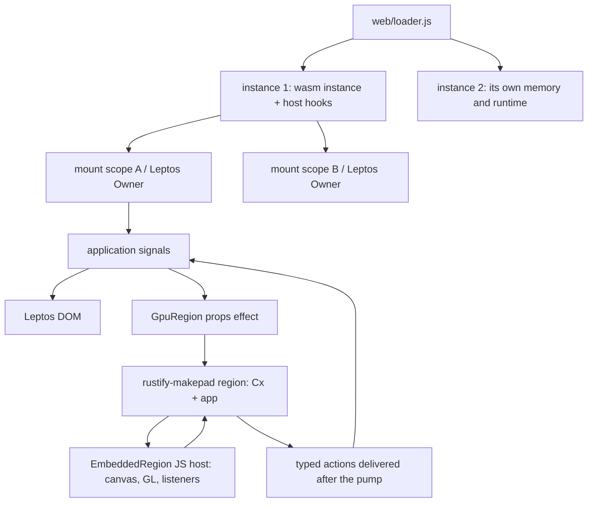

# Architecture

Theme integration below was checked against the working tree of
[`rockie/rustify-ui`](https://github.com/rockie/rustify-ui), branch `dev`, based
on commit `7f5e504` (2026-10-03, `docs: update spec`), including the uncommitted
Theme Studio implementation.

One browser page can run several **instances**, and each instance is a wasm
instance: its own linear memory, its own host hooks, its own diagnostics ring,
its own everything. Inside one instance are **scopes** - the mount points
Leptos owns - and inside a scope are the DOM and, when the application turns on
the SDK's `gpu` feature, the `GpuRegion`s. The default build is DOM only and
links no Makepad. Leptos owns the DOM and the application's reactive state;
every `GpuRegion` owns a Makepad `Cx` that draws into a canvas the DOM laid
out. The two never share widgets or
state: the application projects state into regions as props and receives typed
actions back.

A trap stops at the instance boundary. Everything in the instance it happened
in is gone - every scope, every region, every task - and nothing outside it is
touched, which is what lets an application be embedded on a page it does not
own.

## Crates and files

| Path | Responsibility |
| --- | --- |
| `crates/rustify-dom` | Shared types, application state and DOM runtime. Features: `csr` (default), `ssr` (host rendering), `hydrate` (browser attachment), `utility`, and `external-host` for SDK integration. Owns `runtime`, `mount` / `AppHandle`, IDs, overlays, native text sessions, themes, tasks and the original DOM component subset. Rendering modes are built separately. |
| `crates/rustify-ui` | Git SDK facade. Reexports the core's exact types and adds opt-in `gpu`: `GpuRegion`, region lifecycle, Makepad integration and GPU control implementations. |
| `crates/rustify-components` | DOM components for applications: the two class-string macros forked from Rust/UI (`clx!`, `variants!`), the merge rule they share, the current-path seam a link marks itself current from, and under `css/` the SDK's Tailwind layer (`sdk.css`), the input that compiles it on its own and the committed product (`rustify.css`). |
| `crates/rustify-style` | Pure Rust class tooling without DOM or Makepad: the `cn` merge engine and the `class_variants!` generator components use (default feature), the Oxide-derived scanner (`scanner`, `scanner-fs`), and the Tailwind 4.1.13 compiler with its renderer programs (`compiler`). |
| `crates/rustify-style-wasm` | The single-threaded WASM facade: the cn JS API and the compiler Worker session. `build-web` packages it as the `utility/` Worker product. |
| `crates/rustify-dom/src/utility`, `crates/rustify-ui/src/utility/gpu`, `web/utility-worker.js` | Feature `utility`: `UtilityScope` (Worker transport, CSSOM installation, observer, configuration epochs, recovery) and the GPU resolver; [guide](utility.md). |
| `crates/rustify-makepad` | Private Makepad integration: `RegionApp` trait, region registry with never-reused ids, pump entry points exported to JS, deferred props application, action outbox delivery, `HostHooks` binding, `web/embedded.js` (JS host for regions). |
| `makepad/` | Hard fork of the Makepad wasm closure. Changed for embedding: `platform/src/os/web/web.js`, `web_gl.js`, `libs/wasm_bridge/src/wasm_bridge.js`, `platform/src/os/web/web.rs`, `platform/src/action.rs`, `platform/src/cx.rs`; trimmed to the browser backend; `tools/cargo_makepad` reduced to the single-threaded browser build. |
| `web/loader.js`, `web/runtime.css` | Page-side boot of a GPU build: wasm instantiation, bridge fingerprint and runtime protocol checks, host hooks handed to both Makepad and the SDK runtime, static failure notice. |
| `crates/rustify-dom/web/dom-loader.js`, `dom-runtime.js`, `dom-runtime.css` | Page-side boot of a DOM build: the loader (`runtime::DOM_LOADER_JS`) instantiates the wasm-bindgen output the page names and checks the runtime protocol; the host (`dom-runtime.js`, a wasm-bindgen snippet of the SDK) owns the instance's abort signal, tasks, timers and size observers; the stylesheet (`runtime::DOM_RUNTIME_CSS`) covers the failure notice and the scope's planes. |
| `xtask` | `doctor`, `build-web` (with `--utility-scanner`), `serve` (with `--base`, `--spa` and `--fault`), `report-size` (with `--compressed`), `css` (with `--check`), `catalog` (with `--check`), `sources verify`, `verify --suite p1|p2|p3`, and the utility gates `utility-conformance`, `utility-baseline`, `utility-build`, `utility-bench`. |
| `examples/fusion-basic` | Two mount scopes, each with a DOM counter and two GPU regions bound to the same signal. |
| `examples/component-catalog` | The twenty-four categories, what each supports and where: a nav, a page per category, a status table, a theme switch, a language switch, and one GPU region that draws the scope's tokens so a theme change can be seen reaching both halves. |
| `examples/property-workbench` | A thousand objects with stable ids: a DOM property panel renames, recolours and deletes the selection, a GPU region draws it, and both sides move the selection through the same rule. Also carries the one fixed-version third-party DOM component (`vendor/nouislider`, `src/third_party.rs`) and the rendered capability catalogue. |
| [`examples/vellum`](../examples/vellum/) | A design editor combining one GPU scene with DOM controls, native text sessions and SDK layers; [framework integration and validation](vellum.md). |
| [`examples/theme-studio`](../examples/theme-studio/README.md) | Local theme documents, presets, edit history, saved themes, import/export and DOM/GPU preview scenes. The SDK owns resolution and projection; the example owns editor and persistence state. |
| [`examples/utility-lab`](utility.md) | cn merge input, runtime class compilation and an optional source panel, with scoped DOM and GPU previews side by side. |
| `tests/browser` | Playwright probes run against the release build. |
| `tests/dom-only` | An outside consumer's DOM application (plain Cargo and wasm-bindgen, its own workspace and lock), the GPU opt-in and negative probes, and its browser checks under `playwright.docs.config.ts`. |

## Runtime contracts

- **Region identity.** `RegionId`s come from a monotonic counter and are never reused; a stale id fails every lookup. The JS host carries the id in every export call.
- **Two hosts, one contract.** Whatever an instance hands back to the browser - a listener, a task, a timer, a size observer - goes through the hooks its loader handed to `rustify_runtime_boot`: an abort signal, `defer`, `defer_after`, `observe_resize`, the instance number and the protocol (`runtime::PROTOCOL`). A GPU build hands over the Makepad host, so the SDK and the regions share one; a DOM build gets one from `dom-runtime.js`. Both loaders compare the wasm's protocol with their own before creating anything, the boot compares the hooks' again, and a mismatch is a `BuildContractMismatch` that releases what was created. `mount` refuses with `RuntimeNotStarted` until the runtime has started: a scope whose listeners nothing could end is worse than no scope. `Pace` is the Makepad integration's type with `gpu` and an identical SDK enum without it.
- **Instances.** `boot()` is one instance. The first evaluates the generated glue by static import; each later one evaluates a copy of it under `./bindgen.js?instance=<n>`, because the glue keeps its instance in a module-level binding whose initialiser returns early once it is set - a second `init` of the same module record is a no-op, and a different URL is a different record. All of them share one `WebAssembly.Module`, so there is one compile and one wasm request; what they do not share is linear memory.
- **The instance boundary.** Everything the page hands back is wrapped in a call boundary: an export called after the instance has failed throws `InstanceDead` rather than trapping again, and one that throws `WebAssembly.RuntimeError` reports the failure before rethrowing it. A trap that leaves through a DOM event handler has no code of ours on the stack, so it is attributed by the glue URL in the uncaught error's own stack - each instance has its own. The DOM loader raises V8's ten-frame stack limit (to 200, never lowering it), because without fat LTO a panic spends most of those ten frames before the handler and the glue frame falls off. When an instance fails, the host releases what it holds in a fixed order: abort the signal every page-level listener was registered with, take this instance's mark off the address bar, drop the pending tasks, destroy the regions, and only then tell the page. Nothing later in that list can be reached by something earlier in it.
- **Page-level listeners.** `window`, `document` and a scope's container outlive the scope, and `panic = "abort"` runs no destructor. So every listener the SDK puts on one of them is registered with the instance's abort signal as well (`rustify_ui::runtime::listener_options`): dropping is still the normal path, and aborting is the one removal that works when no Rust can run. An application gets the same through `rustify_ui::listen`, and `release_on_abort` covers what the instance keeps on the page that is not a listener.
- **One address bar, one owner.** The owner is a mark on the document's root element - `data-rustify-url-owner`, valued `<instance>:<scope>` - rather than a flag inside the module. Two instances each have their own copy of everything inside, and each would otherwise conclude it was the only one. The instance number is in the value so that the host can clear the mark of the instance that died and no one else's.
- **Restarting.** A failed instance can be replaced in the same slot at most three times. Every restart evaluates a fresh copy of the glue under a new URL, and a module record lives as long as the document: the dead instance's linear memory is never returned. After the third the only thing left is reloading the page, and the notice says so.
- **Pump.** JS calls `rustify_region_process(region, msg)`; the region's `Cx` is taken out of the registry for the duration of the pump, deferred closures run first inside the same outgoing-message frame (`Cx::process_to_wasm_with`), then Makepad handles the batch. Handlers therefore never observe a borrowed registry, and re-entrant `apply` calls simply queue for the next pump.
- **Props and actions.** `apply(id, f)` queues `f(cx, app)` and asks the host for a pump (coalesced on the microtask queue). Actions pushed into the outbox during a pump are delivered to the application callback after the pump returns, so handlers may write signals or apply new props freely.
- **Presentation.** A pump that only applied props leaves the region wanting to draw, and what Makepad asks for is an animation frame - the next one. The host serves that request itself, at the end of the same microtask, so the picture a projection asked for is in the frame the projection was made in. Without this, two requests fell in one browser frame (the second is dropped as a duplicate while the first is still pending) and a third frame went by unpainted: a region driven once a frame presented every second frame, and a 60 Hz display showed 30. A request made during that draw is a real next frame - an animation running on - and goes back to the browser untouched.
- **Suspending.** A region whose canvas has no area - hidden, `display: none`, a zero-sized box - suspends: it stops presenting and keeps everything it holds, and the application is told, because a region nobody can see is not a broken one. A pump asked for while it is away is remembered and served when it comes back, so the first frame after it returns is the current state rather than the one it left.
- **Resource ledgers.** `stats()` carries two of them. `frames` counts presentations, incremented where a batch binds and clears the canvas; `gpu_bytes` is what the regions' own renderers have allocated - buffers at their last allocated size, textures at width x height x bytes-per-pixel - summed over the instance's live regions and zero once they are gone. Both are accountings the runtime keeps, not readings from the browser or the driver; `docs/compatibility.md` says exactly what the second one does and does not include.
- **Teardown.** `destroy_region` marks the region disposing; if it is idle the JS host releases its browser resources first and the `Cx` is dropped, otherwise the teardown completes when the running pump returns. `AppHandle::dispose` runs the mount scope's reactive cleanups (which destroy its regions) before unmounting the DOM. A `GpuRegion` whose owner was cleaned up before its creation effect ran never creates a region.
- **Process-wide Makepad state.** `Cx::post_action` now targets the `Cx` whose pump is running (the global sender only serves code that runs outside any pump); UI/action signal flags stay global and are polled once per runtime and broadcast to all regions; the live-id interner and widget uid counter are shared by design.
- **Memory views.** Every bridge re-validates its typed-array views of wasm memory on access, because any Rust code in the module (another region, the Leptos application) can grow memory between two calls made through one bridge.
- **Controlled values.** A control never holds the value it shows. In the DOM half, every input event asks the application and then puts the control back in step with whatever the application decided, so a refused value is not left on screen; in the GPU half the widget reports the request and draws the projection that comes back. Disabled and read-only controls ask for nothing at all.
  - **The one exception: a draft.** A text-like input built on `rustify_ui::Draft` - the catalogue's number and colour fields, the editor example's fields - keeps what is being typed while it has focus, because `-`, `1e` and `#1f` are on the way to a value without being one and an application would refuse them from under the person typing. The exception lives only inside the focused input. Until something is typed there, a change to the application's value shows at once; once something is, every input that parses is a preview request the application may refuse without the draft being lost, Enter or leaving the field is one commit request, and Escape drops the draft and asks for the previews to be taken back. Leaving the field ends the exception: it shows the application's value again, whatever the application made of the commit. Everything else - the other controls, a region, a second view of the same value - shows only what the application holds throughout.
- **Theme.** One table of tokens per scope, written onto the scope's own root through the CSSOM (never a `style` attribute, so a strict `style-src` needs no exception) and handed to regions as props. `ThemeOverride` changes part of it for one area: it writes the properties the patch names onto its own element and removes the ones it stops naming, so everything else inherits and the override can be turned off.
- **Styles.** The component classes are unprefixed Tailwind v4 utilities, the same ones an application writes, and a caller's `class` is merged with a component's through `tw_merge`, so it replaces the component's class of the same kind in the same state. This replaces P2's isolation, where a `rui:` prefix kept the SDK's classes apart from a host page's. Three things still keep the SDK off the host's markup: the stylesheet has no preflight and no bare element selector; `dark:` means a scope whose theme is dark (`[data-rustify-scope][data-theme="dark"]`), not a `.dark` ancestor; and the tokens are written only to a scope root - even Tailwind's spacing unit, which shares the name `--spacing`, is compiled into the utilities rather than written to `:root`. What is given up is two Tailwind builds on one page: a host with its own build imports `css/sdk.css` into it rather than also linking `rustify.css`, whose utilities have the same names. A page with no Tailwind links `rustify.css`; an application with its own input gets one stylesheet with both sets of classes.
- **A lost GPU context.** The host prevents the loss from being permanent and stops pumping into the dead context; the region publishes `Lost`, is torn down, and is built again on `webglcontextrestored` with the application's current projection applied before the first draw. Nothing the application holds was ever in the region, so nothing is recovered - it is projected.
- **Diagnostics.** One bounded record per runtime, in `diagnostics`: twenty registered failure classes each with a next step, a count and a byte ceiling, and a `dropped` counter every report leads with. Entry details are `&'static str`, so a user's text has no path into a log.
- **Message bridge.** The web backend's message list is one Rust function (`web_bridge_js_sources`). The build extracts the generated JS from the wasm with `wasmi` and ships it as an ES module with the fingerprint the wasm also exports; the loader compares both before driving the module. No runtime code generation exists in the shipped JS.

## Static scopes and hydration

The static-scope API is implemented in the working tree on `main`, based on
`785f51ad9fdcb69e624a0c8f85d91e3541d58e90` (2026-10-13). The documentation
pipeline uses it to generate HTML during a build; readers receive static files.

`ssr_scope(MountConfig, view)` creates a scope with one content root, one empty
overlay root and an explicit server-rendered marker. The scope name seeds an
independent ID sequence. `hydrate(container, MountConfig, view)` requires the
same scope, base and deterministic initial view, and preserves the existing
content nodes. Build the host with `ssr` and the browser with `hydrate` in
separate Cargo invocations; enabling `csr` and `hydrate` together is rejected.
See [mount.rs](../crates/rustify-dom/src/mount.rs) and
[id.rs](../crates/rustify-dom/src/id.rs).

Boot the DOM runtime before hydration. An external startup script must initialize
Leptos' empty `__RESOLVED_RESOURCES`, `__INCOMPLETE_CHUNKS` and
`__SERIALIZED_ERRORS` arrays. The hydration view closure establishes the SDK
roots, action sink, embedded router, overlay stack, ID allocator and initial
locale; author contexts belong inside that closure because Leptos creates a
new root Owner. Use `provide_static_theme` when the matching theme CSS has
already been generated; it publishes the snapshot without rewriting DOM styles
([provider.rs](../crates/rustify-dom/src/theme/provider.rs)). Start asynchronous
browser work after attachment. Floating demonstrations generate closed triggers;
Leptos portals create their overlay content in the browser.

A runtime occupation marker is separate from the server-rendered marker.
`InvalidHydrationRoot` reports missing or malformed generated roots;
`HydrationIdentityMismatch` reports a different scope, seed or base. These
refusals leave the original DOM intact. Duplicate attachment uses
`OccupiedContainer`; attachment before boot uses `RuntimeNotStarted`. Normal
`AppHandle::dispose` cleans the owning root and removes its DOM. A trapped
instance requires JavaScript to restore its static snapshot; it cannot run Rust
cleanup ([diagnostics.rs](../crates/rustify-dom/src/diagnostics.rs)).

Components that need initial geometry collect external rules through
`provide_geometry_styles(GeometryStyles)`; the build writes `styles.css()` to an
external stylesheet. Browser updates use a scope-owned constructed stylesheet,
with independent selectors across wasm instances. DataTable names its visible
row and cell rules by stable pool slots, so different construction order cannot
change which rule a node uses. No geometry rule is emitted as a `style`
attribute ([geometry.rs](../crates/rustify-components/src/geometry.rs),
[DataTable](../crates/rustify-components/src/data_table/view.rs)).

## Versioned themes

`ThemeDocument` retains light/dark author strings. `resolve` produces one
`ResolvedTheme` containing sRGB RGBA, CSS-pixel geometry, selected fonts,
structured shadows and diagnostics. Applications publish that snapshot to
both renderers; GPU code does not read computed CSS back into its state.
The document and snapshot contracts are in
[document.rs](../crates/rustify-dom/src/theme/document.rs#L108) and
[resolve.rs](../crates/rustify-dom/src/theme/resolve.rs#L133); the studio's
[`PreviewProps`](../examples/theme-studio/src/preview_region.rs#L43) carries
an `Arc<ResolvedTheme>` alongside its application state.

[`ThemeScope`](../crates/rustify-dom/src/theme/provider.rs#L89) claims the mount
root, projects the snapshot through CSSOM and restores prior values on cleanup.
[`ThemeBoundary`](../crates/rustify-dom/src/theme/provider.rs) re-resolves
two-mode patches and local configuration from the original `ThemeSource`,
including an explicit opposite appearance; clearing a patch restores inheritance.
The root provider honors document appearance unless an explicit preview mode
overrides it. CSS dark utilities follow the nearest effective theme through
an inherited mode property and style queries, including projected portal roots.
The root's JS release restores claimed properties and attributes on normal
cleanup and on instance abort, without calling back into failed wasm.
An overlay captures the effective theme signal at its creation point and
updates its layer from that signal
([`overlay.rs`](../crates/rustify-dom/src/overlay.rs#L721)).

Applications opt into the document's geometry, fonts and shadows by importing
[theme-v4.css](../crates/rustify-components/css/theme-v4.css#L1) after
`sdk.css` in their one Tailwind build. Spacing utilities use `--rustify-unit`,
while `--layout-gap` is separate. Missing runtime variables retain legacy
fallbacks, so `Theme`/`ThemePatch` and `ThemedScope`/`ThemeOverride` remain usable.
[`ThemeDocument::from_legacy`](../crates/rustify-dom/src/theme/document.rs#L212)
fills a complete document from two legacy themes; the extended author model
has no lossless conversion back to the opaque legacy palette.

The SDK codec returns validated import candidates without changing editor
state. JSON keeps author values; CSS exports describe the resolved preview.
Static CSS consumers use exported selectors, while dynamic applications import
JSON and update their provider's signal. See [Theme documents](themes.md) for
the schema, scope integration, font packaging and compatibility rules, and
the [Theme Studio guide](../examples/theme-studio/README.md) for editing and
local persistence.

## Build pipeline

1. `cargo-makepad wasm build` (from `makepad/tools/cargo_makepad`, run by xtask through `mbx run`): `mbx build` on the stable toolchain `mise.toml` pins, for the built-in single-threaded `wasm32-unknown-unknown` target with its prebuilt `std`, the fork's link flags with any caller `RUSTFLAGS` appended, resource copy for every dependency crate, in-process `wasm-bindgen`, asserted glue patching (`bindgen_glue.rs`), optional custom-section stripping.
2. `mbx xtask build-web`: clears the output directory, runs step 1, extracts the message bridge, copies `embedded.js`, `loader.js`, `runtime.css` and the example page, compiles the example's `tailwind.css` with the pinned Tailwind CLI (minified, to `tailwind.css`) or, for an example without one that uses the components, copies the committed `rustify.css`, writes `build-manifest.json` (build id, schema hash, toolchain, per-file sizes, six-category size report).
3. `mbx xtask serve`: loopback static server with the release CSP, sub-path support and a negative CSP mode; `--dir` serves any static directory, such as a DOM build.

A DOM application is built without any of the above, the way an outside consumer builds one: `cargo build --release --target wasm32-unknown-unknown --lib` with `--cfg=web_sys_unstable_apis`, the wasm-bindgen CLI at the SDK's pinned version (`--target web`), and the application's own small host program that writes `runtime::DOM_LOADER_JS`, `runtime::DOM_RUNTIME_CSS` and `rustify_components::CSS` beside it ([recipe](quickstart.md#a-dom-application-without-gpu-regions)). `mbx xtask build-dom --manifest-path <Cargo.toml>` does the same inside this repository, and `mbx xtask docs-verify --group features [--external]` checks that the default graph and product carry no Makepad, in the repository and from a git commit outside it.

## Browser tests: two tiers, one page

The Playwright specs ask two different questions, and `tests/tier.ts` decides which one a run asks:

- **Regression** (the default, and every pull request): is the behaviour still right? Every test not tagged `@evidence`, with loops cut to three rounds by `rounds(n)` and parameter matrices cut to a representative subset by `pick(all, representative)`. A deterministic behaviour that holds three times holds; the long counts are there to catch races and leaks.
- **Evidence** (`RUSTIFY_TIER=evidence`; `.github/workflows/evidence.yml` on request and weekly): does a number still meet its budget? Percentiles, bytes, memory tails, frame rates, long runs, idle CPU, the twin comparisons, at their full round counts. A test belongs here when what it asserts is a measurement rather than an outcome. `RUSTIFY_TIER=all` runs both at full strength, and that is what `xtask verify` runs for a release. The frame budgets are the exception to "on request": they are about a machine with a GPU, and headless Chromium draws with SwiftShader, so they skip themselves headless (`GPU_ONLY`) and are run by hand with `--headed` on such a machine.

What makes a regression run slow is not the checks but starting a GPU region: under a software rasteriser every new WebGL context compiles its shaders for seconds. So a worker keeps one page per project, and before each test the fixture in `tests/browser/support.ts` (Vellum: `tests/vellum/support.ts`) calls the example handle's `reset()`, which puts the application back to its first-load state in place, regions kept. Each example's own spec proves that a reset page and a freshly loaded one are the same. A test that has to own its page load - a trap, a deep link, an init script, a context option - declares `test.use({ fresh: true })` and pays for a new context.

## What is delivered, and what is deferred

The component catalogue is twenty-four categories (`crates/rustify-components`); `docs/components.md` is printed from it and records what each supports and what a GPU region draws of it. Routing, workspaces, cross-region drag, the clipboard and file import arrived with P2; large data - a windowed table over a hundred thousand rows, sliced jobs, and a scene of ten thousand GPU objects - arrived with P3, and `docs/data.md` describes it.

Still not provided: threads and `SharedArrayBuffer` (a plain deployment is not cross-origin isolated, so large work is sliced on the one thread there is), a GPU-drawn table, region-level trap isolation, server-side paging, a formula engine, and hot module replacement. What each release measured, and what it could not, is in `docs/reports/p1/`, `docs/reports/p2/` and `docs/reports/p3/`; the per-release limitation lists are the authority on what a pass does not mean.

## Streams, and why they are named

A scope's action queue holds two kinds of thing. A click, a submit or a cancel
is its own event: dropping or reordering one changes what the application did,
so those are queued in arrival order and never merged. A pointer that keeps
moving is a stream of states rather than a history, so only the latest is worth
delivering - and it must not be able to fill the queue and push a click out of
it.

`Pace::Continuous` carries the stream's name, and that name is load-bearing. One
region can have several streams running at once: where the pointer is, what a
drag would land on, how far a list has scrolled, where it drew its controls.
They supersede *themselves* and nothing else. A single slot for the whole scope
- which is what this was until M6 - means whichever stream reported last
silently ate the others, and the symptom is not a crash but a report that never
arrives: the workbench's region drew its controls, said so, and the scroll
report that followed in the same pump took its place.

Each stream keeps the arrival position of its newest state, so a state still
lands on the correct side of the clicks around it.

## Deciding in the same turn as the event

Some things cannot be decided by the region, because the browser needs the
answer before the region can run. A wheel event is the example: `preventDefault`
has to be called during the event, and by the time the region has been pumped
the browser has already been told.

The shape that works is a *report from the last draw*. The region says where its
scrolling has run out at the moment that is a fact - after it draws - and the
host consults that report synchronously when the next wheel arrives. The
consequence is deliberate: the wheel that reaches an edge is still the region's,
because it is judged against the report from before it arrived. Only the next
one belongs to the page, which is also what a person expects.

The same shape covers anything else where the host must answer immediately and
the region is the only one who knows: report the state, decide from the report,
accept that the answer is one event old.
