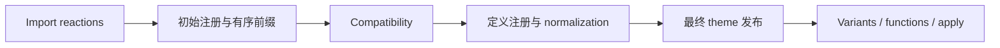

# 初始 directive 注册：统一遍历必须保留的边界

## Overview

目标是保留固定 Tailwind 4.1.13 的首个语义错误，以及错误前调用方 AST 已完成的写入前缀。最终 CSS 相同不能证明这些行为相同。本说明合并 [native 探索](ground-native.md)与[公开 AST 探索](ground-public.md)，并回读下列源码核对关键结论；属于 Ground，不是实现或验收。

**运行证据**：[manifest](manifest.json)记录实际 WASM RED 为 **36 场景 / 72 比较 / 68 失败记录**，其中 **8 首错差异、64 prefix 差异、0 epoch 差异**；分类有重叠，不能相加当失败总数。`fullRegistrationConformance` 仍为 `pending`。计划仍为 **3/7，M4 进行中**（`docs/plan/WASM-TAILWIND.md:37`）；本次未运行测试、构建、浏览器或服务。以下行为结论来自代码观察。

## Key Concepts

- **注册状态**：theme 与首个 theme 输出位置、首个有效 utilities、important、source root / patterns / inline / blocked candidates、按遇见顺序收集的 custom definitions 和 variant applications（上游 `src/index.ts:151`）。它们属于本次 compiler setup，不属于候选增量 revision。
- **原身份与 current view**：`NodeOrigin` / `Origins` 连接 typed AST 与原 caller 对象；`ImportViews` 分别索引原数组当前内容及原对象当前字段；`Edits` 保存共享字段 view。数组位置与对象身份是不同问题（`compile_ast.rs:94`、`:111`；`origin.rs:115`）。
- **journal 与 replay**：`InputMutation::Set/Splice` 指向原 caller target，独立于优化输出；`PreparedAstSetup` 保留成功或语义失败 outcome，WASM `Graph` 才对 live JS handles 实际写入。

## How It Works

### 当前路径与缺口

`Compiler::new_with_ast` 当前依次运行 imports/media、sources、utilities selection、custom variants、variant headers、custom utilities、theme，然后标记 compatibility（`compiler/mod.rs:220`、`:231`、`:250`）。media 已在全树提前处理；functional utility 在 extraction 时立即 normalization/completion，body 随即移入 definition（`custom_utilities.rs:256`、`:271`）。因此后面的 theme reader 看不到该 body。

早期 extraction 使用 `?` 退出，只有更晚的 functions/apply 有失败回调（`mod.rs:299`、`:305`、`:325`）。公开失败 outcome 当前只能保存已回调记录的效果；不能从最终 theme projection 重建被遗漏的早期前缀。RED 证明这批输入存在差异，源码说明其机制；二者都不证明完整 M4。

### 固定上游的初始 walk

上游先完成 import substitution，再执行可修改数组的前序 walk（`ref/tailwindcss/packages/tailwindcss/src/index.ts:149`、`:164`；`src/ast.ts:150`）。同级按当前数组顺序；Context 不作为节点访问、不改变 parent，字段通过对象 spread 覆盖继承值，故显式 `reference:false` 可以清除祖先 true。替换立即更新当前位置：Continue 重访替换节点，Skip 越过替换节点及其子树；首错停止后续 siblings。

每个 at-rule 依次判定 utilities、utility、source、variant、custom variant、media、theme。关键副作用顺序不能合并成“全部验证后删除”：

| 指令 | 必须保留的行为 |
| --- | --- |
| utilities | 已选中或 reference 时先删除，跳过选项验证；首个有效节点才解析 source root。 |
| utility | nesting → empty body → name；收集延后注册工作，初始 walk **继续进入 body**。 |
| source | 非空 body → nesting → quotes/展开；成功后删除。 |
| variant | 仅 root 无 body/空 body 或含 descendant slot 才转定义；先赋 `name`，同次访问继续 custom-variant 处理；其他应用延后。 |
| custom variant | 先查 nesting，**先删除，再验证** name/body/selector；移除后的 body 不进入初始 walk。 |
| media | 按参数 token 顺序传播 source/theme/prefix、important/reference；未知条件保留，否则 flatten 并重访 replacements。传播所需局部子 walk 仍存在。 |
| theme | 先解析所有 options、选最后 prefix；验证 prefix/body 后才替换首个位置为空 rule或删除后续位置，随后 Skip。body walk 穿透 Context，遇 keyframes 只保留、不进入其 body。 |

上述顺序见 `index.ts:169`、`:219`、`:253`、`:306`、`:347`、`:442`、`:529`。同一 theme 的空最后 prefix 不清除已有 prefix；不同 blocks 按遇见顺序影响 theme。

初始 walk 全部成功后，才跨 compatibility，注册 custom variants、custom utilities并 normalization，发布最终 theme.nodes，再应用 variants、functions、apply，最后转换 utilities和删除 utility definitions（`index.ts:600`、`:608`、`:616`、`:639`、`:663`、`:668`）。现有 eager normalizer不能直接放进统一初始 visitor。

### Ownership 与回放分界

主题首位置的 **空 rule 数组替换** 位于 compatibility 前；其最终 `nodes` assignment 位于 normalization 后，两者不能折叠（`compile_ast.rs:633`、`:1787`）。definition body、keyframes、原 caller aliases 与最终输出各有所有者，移入 native registry不授权清空 caller body。公开 Source canonical tuple保留共享 Source、额外字段和 JS offsets；typed offsets为 UTF-16（`public_api/source_map.rs:7`）。source discovery metadata是另一种数据。

imports仍由 Program/Machine 管理 occurrence、begin 空 context、complete同一 context与失败后已启动任务；effects枚举只是 reserve，不是实际时间顺序。ParseCss回放 initial前缀，Compatibility回放后段（`compile_ast/setup.rs:273`）。同步入口本次调用驱动队列；Promise入口逐个投递真实 microtask，没 imports也有 synthetic root（`:129`；WASM `setup.rs:248`、`:282`）。

native reserve、完整潜在 journal与 WASM handles预算在 start 前 admission；Limit直接失败，不 replay AST writes（WASM `setup.rs:227`）。实际 Set必须执行，Splice调用 target自己的方法；先发生的 host exception保留原值并优先于尚未发布的 semantic error。setter捕获的新 context即使抛错也保留，root reject不取消已启动 import工作（WASM `graph.rs:172`、`:297`；`setup.rs:167`）。

## Where Things Live

实现入口为 `compiler/mod.rs`；指令语义在 `sources.rs`、`imports.rs`、`custom_variants.rs`、`custom_utilities.rs`、`theme.rs`、`variants.rs`。身份/日志连接点为 `origin.rs`、`public_api/compile_ast.rs`及其 `setup.rs`；真实 crossing在 `rustify-style-wasm/src/public_api/{graph,setup}.rs`。

## Gotchas

公开 theme/media重扫目前跳过 utility body（`compile_ast.rs:669`），native media不跳过 utility（`imports.rs:255`），而上游初始 walk进入 utility。三者不是同一个遍历契约；公开源码中“parseCss不遍历utility body”的注释不能作为上游事实。native Context reference使用 OR（`sources.rs:233`），也不等于上游 override。

共享对象修改必须影响后续访问的 current字段，共享数组删除必须改变后续位置；不能只补 journal而仍读取旧快照。成功 Proxy动态修改、完整 helpers/API/loader、统一峰值、性能和浏览器义务仍待独立验证。现有reserve不是实测allocator峰值；admission无 AST写入也不保证读取getter无用户副作用。
