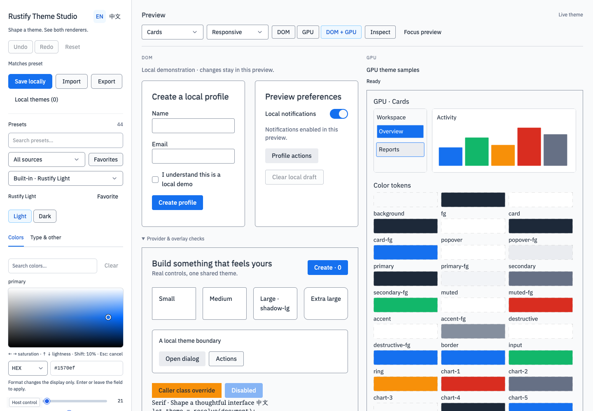

  
实验性 Rust SDK默认 DOMGPU 可选

  <section aria-label="DOM 与 GPU 如何协作" class="group/collaboration relative mt-12 overflow-hidden rounded-2xl bg-[#2348e5] text-white md:mt-14">
    

      

        
DOMLeptos

        
处理布局、表单与响应式应用状态。

      

      
+

      

        
GPUMakepad

        
为需要 GPU 绘制的内容，按需启用 WebGL2 区域。

      

    

    
共享状态 · 类型化动作 · 同一个应用<a class="inline-flex min-h-8 items-center gap-2 font-medium text-white! underline-offset-4 focus-visible:outline-[#c9f3dd] focus-visible:outline-offset-4" href="https://rockie.github.io/rustify-ui/zh/architecture/">了解协作机制<svg aria-hidden="true" class="h-4 w-4 transition-transform duration-200 ease-out motion-safe:group-hover/collaboration:translate-x-1 motion-safe:group-focus-within/collaboration:translate-x-1 motion-reduce:transition-none" viewBox="0 0 24 24" fill="none" stroke="currentColor" stroke-width="1.7"><path d="M5 12h14m-5-5 5 5-5 5"/></svg></a>

  </section>

  <section aria-labelledby="built-for-the-real-work" class="py-20 md:py-28">
    

      <h2 id="built-for-the-real-work" class="max-w-[15ch] text-3xl! font-semibold! leading-tight! tracking-[-0.03em] md:text-4xl!">原生浏览器体验， 按你的方式组合。</h2>
      
从 DOM 应用开始，在需要时加入 GPU 区域。Rustify 负责两者之间的状态、生命周期、输入与浮层协作。

    

    

      
<h3 class="text-lg! font-semibold!">DOM，负责界面与状态。</h3>
用 DOM 组件构建表单、导航、文本编辑与大型表格，由 Leptos 管理布局和响应式应用状态。

      
<h3 class="text-lg! font-semibold!">GPU，专注需要绘制的区域。</h3>
将 Makepad 挂载到 DOM 定位的区域，传入 props，接收类型化动作；应用状态由一处统一管理。

      
<h3 class="text-lg! font-semibold!">一套主题，贯穿两端。</h3>
跨渲染器共享语义主题值，为应用的不同区域隔离主题，同时协调控件、焦点与浮层。

    

  </section>

  <section aria-labelledby="from-components-to-workspaces" class="rounded-2xl bg-[#e7edf8] px-6 py-10 md:px-12 md:py-14">
    

      <h2 id="from-components-to-workspaces" class="max-w-[18ch] text-3xl! font-semibold! leading-tight! tracking-[-0.03em] md:text-4xl!">看组件， 也看它们如何协作。</h2>
      <a class="inline-flex min-h-11 items-center gap-3 text-sm font-semibold text-[#173dc8]! underline-offset-4" href="https://rockie.github.io/rustify-ui/zh/themes/">了解 Theme Studio<svg aria-hidden="true" class="h-4 w-4" viewBox="0 0 24 24" fill="none" stroke="currentColor" stroke-width="1.7"><path d="M5 12h14m-5-5 5 5-5 5"/></svg></a>
    

    <figure class="mt-8!">
      

      <figcaption class="mt-4 text-xs leading-relaxed text-[#4a5870]">Theme Studio 真实示例：基于 Rustify UI 构建，将 DOM 编辑与 GPU 预览放在同一界面中。</figcaption>
    </figure>
    
<a class="min-h-8 content-center font-medium text-[#173dc8]!" href="https://rockie.github.io/rustify-ui/zh/components/button/">浏览组件</a><a class="min-h-8 content-center font-medium text-[#173dc8]!" href="https://rockie.github.io/rustify-ui/zh/vellum/">了解 Vellum 编辑器</a><a class="min-h-8 content-center font-medium text-[#173dc8]!" href="https://github.com/rockie/rustify-ui/tree/main/examples">在 GitHub 查看全部示例</a>

  </section>

  <section aria-labelledby="start-with-a-region" class="grid gap-10 py-20 md:grid-cols-2 md:gap-16 md:py-28">
    
<h2 id="start-with-a-region" class="max-w-[15ch] text-3xl! font-semibold! leading-tight! tracking-[-0.03em] md:text-4xl!">从一个小示例， 开始你的应用。</h2>
从共享计数器到设计编辑器，仓库提供可运行的示例。先运行最小示例，再沿着指南接入自己的应用。
<a class="mt-6 inline-flex min-h-11 items-center gap-3 text-sm font-semibold text-[#173dc8]! underline-offset-4" href="https://rockie.github.io/rustify-ui/zh/quickstart/">阅读快速上手<svg aria-hidden="true" class="h-4 w-4" viewBox="0 0 24 24" fill="none" stroke="currentColor" stroke-width="1.7"><path d="M5 12h14m-5-5 5 5-5 5"/></svg></a>

    

运行最小示例shell
<pre tabindex="0" role="region" aria-label="克隆并运行最小示例的命令" class="m-0! overflow-x-auto border-0! bg-transparent! p-6! text-[13px]! leading-7! text-[#eef3ff]!"><code class="bg-transparent! text-inherit!">git clone https://github.com/rockie/rustify-ui.git
cd rustify-ui
mise install
mbx xtask build-web --example fusion-basic --release
mbx xtask serve --example fusion-basic --release</code></pre>
已在 macOS Chrome 验证。环境配置与浏览器支持范围见文档。

  </section>

  <section aria-labelledby="your-next-interface" class="flex flex-wrap items-center justify-between gap-8 rounded-2xl bg-[#c9f3dd] px-6 py-10 md:px-12 md:py-14">
<h2 id="your-next-interface" class="max-w-[18ch] text-3xl! font-semibold! leading-tight! tracking-[-0.03em] md:text-4xl!">下一个界面， 用 Rust 开始。</h2>
也可以用测试信息，体验一次 CTA 表单提交。

<a class="inline-flex min-h-14 items-center gap-4 rounded-xl bg-[#16243b] px-6 text-sm font-semibold text-white! transition-colors motion-reduce:transition-none hover:bg-[#30425e]" href="cta.md">测试 CTA 表单<svg aria-hidden="true" class="h-4 w-4" viewBox="0 0 24 24" fill="none" stroke="currentColor" stroke-width="1.7"><path d="M5 12h14m-5-5 5 5-5 5"/></svg></a></section>

  <footer class="mt-16 flex flex-wrap items-center justify-between gap-6 border-t border-[#ccd5e5] py-8 text-xs leading-relaxed text-[#596780]">
Rustify UI · 面向 Web 的实验性 Rust SDK。
<nav class="flex flex-wrap gap-6" aria-label="项目链接"><a class="inline-flex min-h-8 items-center text-[#34435b]!" href="https://rockie.github.io/rustify-ui/zh/">GitHub Pages 文档站</a><a class="inline-flex min-h-8 items-center text-[#34435b]!" href="https://github.com/rockie/rustify-ui">GitHub</a></nav></footer>

