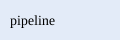

# Guide

This guide covers [setup](setup.md#install-the-cli) and the [reference](../reference/api.md#数据-api).

> [!TIP]
> Start with `check`; it changes nothing.

> [!IMPORTANT]
> Every link is resolved before a build is published.

> [!CAUTION]
> A page with inline script is refused.

## Steps

Read the setup page first.

## Steps

Then write a page.

<p align="center"></p>

<a href="setup.md#check-the-version">Check the version</a> when you are done.

## All done {#100%}

<p><svg width="40" height="40" role="img" aria-label="The fixture's mark"><use href="/sprite.svg#mark"></use></svg></p>

<div class="h-10 bg-[url(/banner.svg)] bg-no-repeat" role="img" aria-label="A banner"></div>

## Check your install

<!-- rustify:code-group name="install" -->

```sh title="Cargo"
rustify-docs --version
```

```toml title="Config"
schema_version = 1
```

<!-- rustify:end-code-group -->
